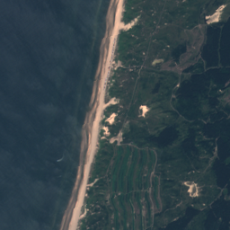
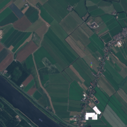
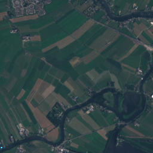
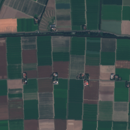
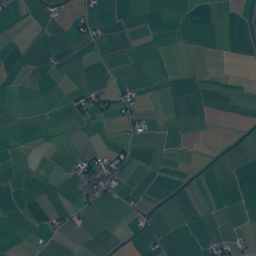

# Fine-tuning Qwen3-VL-4B for remote-sensing VQA (RSVQA-LR)

This repo contains the full pipeline for fine-tuning (LoRA) of [Qwen3-VL-4B](https://huggingface.co/Qwen/Qwen3-VL-4B-Instruct) on RSVQA-LR dataset. RSVQA-LR (Low Resolution) is a visual question answering benchmark on 10 m Sentinel-2 images. The evaluation is conducted to understand what the model can inherently understand (zero-shot testing) and how far fine-tuning can improve results and separates what the model can learn through images and what it can guess from text questins alone.

**TL;DR**

- LoRA fine-tuning on the VLM raises test accuracy from 57.3% (zero-shot) to **87.8%**. On the question types reported by recent vision-language models, this is in the same range as published fine-tuned models.
- A data baseline that never sees the images (the most frequent training answer for each question text) already reaches 68.8% overall accuracy. Showing repetition of questions and how much of the benchmark can be answered from just questions.
- Over that prior baseline, fine-tuning adds +3.7 points on presence and +6.1 on comparison, but +28.2 on counting and +38.0 on rural/urban type questions, the two types where the question gives little away and image context is most important.

LoRA adapter: [Download here](https://huggingface.co/Random-Sandwiche/rsvqa-qwen3-vl-lora) from Hugging Face.

## Results

Test split, evaluated once for numbers after adapter selection and hyperparameter tuning on validation split.

| Method | Presence | Comparison | Count | Rural/urban | Avg Accuracy |
|---|---:|---:|---:|---:|---:|
| Majority answer per question (no image) | 88.3 | 87.1 | 43.7 | 56.0 | 68.8 |
| Qwen3-VL-4B zero-shot, no image | 72.2 | 70.2 | 25.0 | 56.0 | 55.9 |
| Qwen3-VL-4B zero-shot | 64.5 | 72.5 | 28.9 | 70.0 | 59.0 |
| **Qwen3-VL-4B + LoRA** | **92.0** | **93.2** | **71.9** | **94.0** | **87.8** |
| Qwen3-VL-4B + LoRA, no image | 87.6 | 89.2 | 35.8 | 56.0 | 67.2 |
| *LoRA minus no-image prior* | *+3.7* | *+6.1* | *+28.2* | *+38.0* | *+19.0* |

</details>

## Findings

**1. The question carries much of the answer.** RSVQA-LR questions come from a small set of templates and the answers come from OpenStreetMap, so answer distributions per question are very skewed. Predicting the most frequent training answer for each question text, without looking at the image, scores 88.3% on **presence** and 87.1% on **comparison**.

**2. Where the image is needed, fine-tuning helps a lot.** The gains over the prior are concentrated in **counting (+28.2)** and **rural/urban (+38.0)**. Rural/urban is a pure image test, because every image gets the same question, so the prior can only ever predict one class. This can also be seen in the abalation for fine-tuned with no image input, the worst hit are counting and rural/urban, with presence and comparison affected at a lower degree.

**3. Zero-shot, adding the image hurts on presence.** Without the image the base model scores 72.2% on presence, with it 64.5% (val: 73.4% vs 62.7%). A plausible explanation is the resolution limit. With a 10 m resolution many objects that OpenStreetMap records (single buildings, small roads) are not visible, so the model answers "no" where the map-derived answer is "yes". The RSVQA authors also note this resolution limit themselves for their LR dataset.

## Examples

### Correct

An example of a correct prediction of the fine-tuned model on an image in test split. Count prediction is shown after binning.



| Type | Question | Truth | Prediction |
|---|---|---|---|
| Count | What is the amount of small water areas? | 4 | 1–10 |
| Presence | Is a large water area present? | yes | yes |
| Comparison | Is the number of buildings equal to the number of roads? | no | no |
| Rural/urban | Is it a rural or an urban area? | rural | rural |

### Error

Few examples of wrong predictions of the fine-tuned model on the test split. 

| Type | Question | Truth | Prediction | Image |
|---|---|---|---|---|
| Count | How many commercial buildings are there? | 11–100 | 1–10 |  |
| Presence | Is a medium commercial building present? | no | yes |  |
| Comparison | Are there less residential buildings than farmlands? | no | yes |  |
| Rural/urban | Is it a rural or an urban area? | rural | urban |  |

- A commercial building is only a few pixels at 10 m resolution. This low resolution could be a leading cause for undercounting cases.
- Size and shape words ("medium", "square") come from the geometry of OpenStreetMap polygons and are hard to verify at this resolution.
- Comparison answers are computed from OpenStreetMap objects (like how many separate road and water objects are mapped), which is not always visible in the images. Comparisons between object types that are rare in the training data may also be harder to grasp for the model.

## Comparison with published results

| Method | Presence | Comparison | Rural/urban | Count |
|---|---:|---:|---:|---:|
| RSVQA (Lobry et al., 2020) | 87.46 | 81.50 | 90.00 | 67.01 |
| **Qwen3-VL-4B + LoRA (this repo)** | **92.0** | **93.2** | **94.0** | **71.9** |
| Majority answer per question, no image (this repo) | 88.3 | 87.1 | 56.0 | 43.7 |

## Setup and reproduction

Python 3.12 with [uv](https://docs.astral.sh/uv/). torch is pinned to the CUDA 12.6 build in `pyproject.toml`. Clone the repo and run `uv sync` to install dependencies. 

### Data and models

For the data, I used the Remote Sensing Visual Question Answer Low Resolution (RSVQA-LR) dataset which has 772 Sentinel-2 RGB images and 77,232 questions\answers. I use the official train/val/test splits from [Zenodo record 6344334](https://zenodo.org/records/6344334), with a filter to remove inactive questions. As for the model, I used [Qwen3-VL](https://huggingface.co/collections/Qwen/qwen3-vl) (the 2B and 4B variant). To download the data and models,
```bash
python dw_assets.py
```
To explore the data structure and model architecture and inputs,
```bash
python scripts/explore_data.py
python scripts/explore_model.py
```
To obtain the baseline result, majority answer per question based on data stat and no image,
```bash
python scripts/dataset_baseline.py
```

### Fine-tuned LoRA adaptor

LoRA (PEFT) fine-tuning was done on the language model's linear layers: q, k, v, o, gate, up projection and  down projection. Vision encoder and vision-language merger was frozen. r = 16, alpha = 32, dropout 0.05. Download LoRA adapters for both 2B and 4B variant [here](https://huggingface.co/Random-Sandwiche/rsvqa-qwen3-vl-lora) and place it under folder `runs/`.
To evaluate the adapter, 
```bash
python scripts/evaluate.py --model 4B --split test --out test_eval --adapter runs/4B_lora_adapter
# Blind evaluation can be done with 
python scripts/evaluate.py --model 4B --split test --out test_eval --adapter runs/4B_lora_adapter --blind
```
To fine-tune the model yourself,
```bash
python python scripts/fine_tune.py --config configs/fine_tune.yaml
```
Multiple saved adapters can be evaluated using `run_multi.py`, it will determine the number of GPU's avaliable and scale the number of processes automatically.
```bash
python python scripts/run_multi.py --path results/runs/fine_tune_4B
```

## Repository structure

```
data/
  configs/     training configs (fine_tune.yaml, overfit_test.yaml)
  rsvqa_lr/    main dataset
example_images/
models/        Qwen3 *B models
results/       metrics JSON per run, training config
runs/          downloaded adapters
scripts/
  utils.py             data loading, prompt building, normalization, scoring
  explore_data.py      dataset statistics
  explore_model.py     model inspection
  dataset_baseline.py  majority-answer baseline
  fine_tune.py         LoRA training loop
  evaluate.py          batched evaluation, writes metrics JSON and per-question CSV
  run_multi.py         for multi adapter evaluation, scales to number of GPU's
dw_assets.py downloads dataset and models at pinned revisions
```